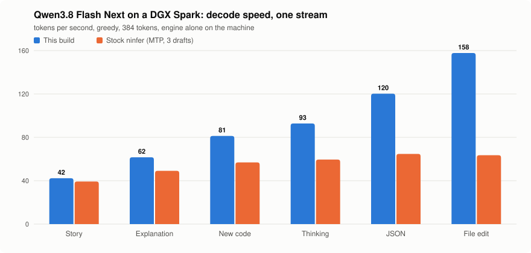

<div align="center">

# ninfer-flash-next-spark

**Qwen3.8 Flash Next on an NVIDIA DGX Spark, with a DFlash2 drafter in [ninfer](https://github.com/Neroued/ninfer)**

A patch set that makes one 121 GB desktop machine decode a 74 GB model at 42 to 158 tokens a second,<br>
without changing a single token the model would have chosen.

[](LICENSE)
[-76b900.svg)](docs/build.md)
[](https://github.com/Neroued/ninfer/commit/13ebb92f6f1d56b676e5300cb19555b2ba24053a)
[](https://github.com/ientzy/ninfer-flash-next-spark/actions/workflows/patches.yml)

<picture>
  <source media="(prefers-color-scheme: dark)" srcset="assets/results-dark.svg">
  
</picture>

</div>

## What this is

[ninfer](https://github.com/Neroued/ninfer) is an inference engine with hand-tuned kernels for the DGX Spark.
Out of the box it runs Qwen3.8 Flash Next with the model's own MTP draft head. This repository is nine patches
on top of it, plus the scripts to build, fetch the model and serve:

| | |
|---|---|
| **DFlash2 drafter** | Runs [`incoai/Qwen3.8-Flash-Next-DFlash2`](https://huggingface.co/incoai/Qwen3.8-Flash-Next-DFlash2) as the drafter: 7 draft tokens from one pass instead of one MTP step per token. Added to the existing model files without reconverting them. |
| **Spark 8-bit drafter layout** | The drafter's large matrices are stored 8-bit and projections of the same input share one weight, with fused kernels. |
| **Automatic draft width** | Each round verifies only as many drafts as the drafter's own confidence says will pay off. |
| **Several streams** | Up to 8 requests at once, each with its own drafter state and its own draft count per round. |
| **Copy extension** | When the model is repeating earlier text (an edit, a quote, a file), a round continues past the 7 drafts with the tokens that followed last time, up to 15. |
| **Output head screen** | An 8-bit copy of the output head finds the tokens that can be in the top 20; only those are computed at full precision. The 1.27 GB head is no longer read every round. |

Every draft is still verified by the full model, so speculation changes speed and not the output.
[How it works](docs/how-it-works.md) explains each piece and what was measured before building it.

## Results

One stream, greedy, 384 tokens, engine alone on a DGX Spark, tokens per second:

| Text | Stock ninfer<br>(MTP, 3 drafts) | **This build** | Gain |
|---|---:|---:|---:|
| Story | 39.3 | **42.3** | +8% |
| Explanation | 49.1 | **61.6** | +25% |
| New code | 56.9 | **81.3** | +43% |
| Thinking | 59.5 | **92.8** | +56% |
| JSON from notes | 64.7 | **120.3** | +86% |
| Edit a file | 63.5 | **157.8** | +149% |
| Text repeated exactly | | **185** | |

- Several streams: about 80 tok/s total at 2, 95 at 4, 125 to 130 at 8.
- These are single runs, good to about 5%. Sampling (temperature, top-p, top-k, min-p) runs at the same
  speeds within that.
- Method, every intermediate step and the commands to repeat them: [docs/results.md](docs/results.md).

## Quick start

On a DGX Spark (tested on Ubuntu 24.04 with driver 580.178.04). You need about 110 GiB of disk and no other
large model loaded.

```bash
git clone https://github.com/ientzy/ninfer-flash-next-spark.git
cd ninfer-flash-next-spark

sudo apt install ninja-build pkg-config libjpeg-dev libhwloc-dev liburing-dev \
     libavformat-dev libavcodec-dev libavutil-dev libswscale-dev

scripts/install-cuda.sh     # CUDA 13.4 compiler into ~/cuda-13.4, no sudo, system untouched
scripts/setup.sh            # ninfer at the pinned commit + the patches, then build
scripts/get-model.sh        # model (101 GiB) + drafter (1.1 GiB), joined into one file set
scripts/serve.sh            # OpenAI-compatible server on 127.0.0.1:8080
```

Then:

```bash
curl -s localhost:8080/v1/chat/completions -H 'Content-Type: application/json' -d '{
  "model": "qwen3.8-flash-next",
  "messages": [{"role": "user", "content": "Write a haiku about unified memory."}]
}'
```

The first start takes about 95 seconds (30 to load the weights, the rest to capture CUDA graphs).
[docs/build.md](docs/build.md) has the details and the things that go wrong.

## Switches

Everything new is behind an environment variable, so the same binary and the same files also run stock MTP.
`scripts/serve.sh` sets the measured defaults:

| Variable | Default in `serve.sh` | Meaning |
|---|---|---|
| `NINFER_FLASH_DFLASH2` | `1` | Use the drafter instead of MTP steps |
| `NINFER_FLASH_DFLASH2_AUTO` | `17` | Automatic draft width; the fixed cost of a round, in verify columns |
| `NINFER_FLASH_DFLASH2_AUTO_POWER` | `2` | Power applied to the drafter's confidence |
| `NINFER_FLASH_DFLASH2_COPY` | `8` | Copy extension; how many newest tokens must repeat earlier text |
| `NINFER_FLASH_HEAD_SCREEN` | `1` | Output head screen; `check` runs both heads and counts differences |

The full list, with the ones you will rarely touch: [docs/configuration.md](docs/configuration.md).

## Is the output really unchanged?

Speculative decoding is exact by construction: a draft is kept only if the full model picks the same token
(greedy) or accepts it under the standard acceptance rule (sampling). What this repository adds on top is
checked as follows.

- **Head screen.** A check mode runs the full head next to the screened one. Over 6,858 verify positions
  (greedy, sampled, two streams): 0 top-20 tokens missed, 0 positions with a different first token. Twelve
  test texts (greedy and fixed-seed sampling) are character-for-character identical with the screen on and off.
- **Copy extension and wider windows.** A hint is used only when the drafter's own 7 drafts agree with it, and
  every token is still verified.
- **What can differ.** Runs with a different number of drafts per round sum floating-point values in a
  different order, so two equally likely tokens can occasionally swap and a text can take another, equally
  valid path. This is true of any speculative decoder and of stock ninfer at different draft settings.

`bench/bench.py edge` and `NINFER_FLASH_HEAD_SCREEN=check` let you repeat the checks on your machine.

## Limits

- **One machine, one model.** Built and measured on a single DGX Spark with Qwen3.8 Flash Next. The kernels
  target the Spark (`sm_121a`); nothing here was tried on other hardware.
- **Research code.** The switches are environment variables, the patches have not been reviewed upstream, and
  the test coverage is the bench in this repository.
- **Memory.** The model takes about 100 GiB of the Spark's 121 with a 12 GiB context store. There is no room
  for a second large model beside it.
- **Several streams** gain less than one stream: rounds with more than 16 columns keep the full output head,
  and a window of 15 makes a round at 8 streams about 4% slower than a window of 7.
- **Grammar and penalties.** Requests with JSON mode or a presence/frequency penalty use the full output head
  (same speed as before the screen).

## Repository layout

```
patches/     nine patches for ninfer at 13ebb92 (git am)
scripts/     install-cuda.sh, setup.sh, get-model.sh, serve.sh
tools/       graft_dflash2.py: adds the drafter to an existing ninfer file set
config/      server configuration
bench/       bench.py: speed, streams, sampling, JSON and exactness checks
docs/        how it works, results, build, configuration
```

## References and credits

This work stands on other people's:

- **[ninfer](https://github.com/Neroued/ninfer)** by Neroued (Apache-2.0): the engine, its DGX Spark kernels and
  the Flash Next artifact [`neroued/Qwen3.8-Flash-Next-NInfer`](https://huggingface.co/neroued/Qwen3.8-Flash-Next-NInfer).
  Everything here is a patch on it.
- **[Infernix](https://github.com/Wallawalla47/Infernix)** by Wallawalla47 (Apache-2.0), a ninfer fork for the
  RTX 5090: the reference for the Flash Next DFlash2 drafter's mathematics and the idea of verifying only as
  many drafts as the drafter's probabilities justify.
- **[cinference](https://github.com/satellitedown/cinference)** by satellitedown (Apache-2.0): the idea of
  prompt-lookup rounds.
- **[`incoai/Qwen3.8-Flash-Next-DFlash2`](https://huggingface.co/incoai/Qwen3.8-Flash-Next-DFlash2)** (Apache-2.0):
  the drafter weights. DFlash2 drafters for the Qwen3.8 family: [`z-lab/Qwen3.8-27B-DFlash2`](https://huggingface.co/z-lab/Qwen3.8-27B-DFlash2).
- **[Qwen3.8 Flash Next](https://huggingface.co/Qwen/Qwen3.8-Flash-Next)** by the Qwen team, and NVIDIA's
  [NVFP4 release](https://huggingface.co/nvidia/Qwen3.8-Flash-Next-NVFP4), the sources of ninfer's artifact.
- NVIDIA's [CUDA redistributables](https://developer.download.nvidia.com/compute/cuda/redist/), which
  `scripts/install-cuda.sh` downloads.

Model weights are not part of this repository; their own licences apply.

## License

[Apache-2.0](LICENSE), the same as ninfer. See [NOTICE](NOTICE).
